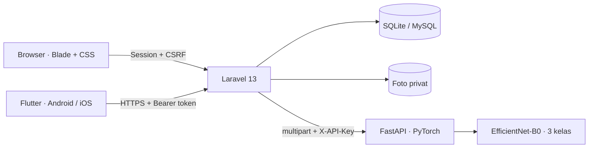

# Bersih — Smart Waste Management System

Website Laravel, aplikasi Flutter, dan klasifikasi gambar Python/PyTorch dalam satu repository. Antarmuka berbahasa Indonesia menggunakan layout sederhana, warna netral, dan aksen hijau.

## Yang tersedia

- **Website:** login/register, role Admin/User, ringkasan statistik, grafik periode 7/30/90 hari, CRUD laporan, pencarian, filter kategori/status, pagination, manajemen pengguna, foto privat, dan riwayat perubahan status.
- **Flutter:** login/register, token di secure storage, dashboard, riwayat/pencarian/filter/pagination, detail laporan, kamera/galeri, GPS dengan fallback koordinat manual, dan saran kategori AI.
- **API:** Laravel Sanctum, endpoint versi `/api/v1`, validasi input, pembatasan akses per pemilik, rate limiting, dan proxy ke FastAPI.
- **ML:** EfficientNet-B0 pretrained ImageNet dengan classifier PyTorch yang dilatih pada tiga kelas. Model terlatih dan dataset asli sudah disertakan.
- **Evaluasi nyata:** **98,32% accuracy** pada **179 gambar testing**. Data testing tidak digunakan untuk training atau pemilihan epoch.

| Dokumen / artefak | Lokasi |
|---|---|
| Dokumentasi REST API dan contoh request | [docs/api.md](docs/api.md) |
| OpenAPI 3.1 untuk Postman/Swagger | [docs/openapi.json](docs/openapi.json) |
| ERD, kamus data, dan aturan akses | [docs/database.md](docs/database.md) |
| Schema SQLite hasil database nyata | [docs/schema.sqlite.sql](docs/schema.sqlite.sql) |
| Dataset, sumber, dan lisensi | [machine-learning/DATASET.md](machine-learning/DATASET.md) |
| Hasil evaluasi dan keterbatasan | [machine-learning/EVALUATION.md](machine-learning/EVALUATION.md) |
| Confusion matrix | [machine-learning/artifacts/confusion_matrix.png](machine-learning/artifacts/confusion_matrix.png) |
| Classification report | [machine-learning/artifacts/classification_report.txt](machine-learning/artifacts/classification_report.txt) |
| Model terlatih | [machine-learning/artifacts/model.pt](machine-learning/artifacts/model.pt) |
| Panduan mobile | [mobile/README.md](mobile/README.md) |
| Checklist pengujian | [docs/testing.md](docs/testing.md) |

## Arsitektur



Laravel menjadi satu pintu autentikasi dan data. Flutter tidak perlu mengakses layanan Python secara langsung. Kategori akhir dipilih pengguna; nilai AI pada laporan dihitung kembali oleh backend, bukan dipercaya dari input client. Jika AI sedang tidak tersedia, laporan tetap tersimpan dengan kategori manual.

## Prasyarat

- PHP **8.3+** (diuji dengan 8.4.23), Composer 2; ekstensi PDO SQLite atau MySQL, fileinfo, mbstring, openssl, dan GD untuk test upload.
- Node.js **22.12+** dan npm (diuji dengan Node 24).
- Python **3.11+** dengan pip dan venv (diuji dengan Python 3.14.3, PyTorch CPU 2.15.0).
- Flutter stable dengan Dart **3.13.4+**, Android SDK dan JDK 17+; iOS membutuhkan macOS/Xcode.
- Koneksi internet untuk instalasi dependensi. Inferensi model setelah instalasi tidak memerlukan internet.

## 1. Menjalankan website dan API

Jalankan dari root proyek:

```powershell
composer install
Copy-Item .env.example .env
php artisan key:generate
php -r "file_exists('database/database.sqlite') || touch('database/database.sqlite');"
php artisan migrate
php artisan db:seed
npm install
npm run build
php artisan serve --host=127.0.0.1 --port=8123
```

Jika `.env` sudah ada, pertahankan konfigurasi Anda dan lewati perintah `Copy-Item`. Di Linux/macOS gunakan `cp .env.example .env`.

Buka **http://127.0.0.1:8123**. Port 8123 dipilih untuk menghindari bentrok dengan aplikasi lokal lain pada port 8000.

Akun **demo lokal** setelah seeding:

| Role | Email | Kata sandi |
|---|---|---|
| Admin | `admin@bersih.test` | `Bersih123!` |
| User | `user@bersih.test` | `Bersih123!` |

Seeder membuat 48 laporan contoh dan beberapa warga fiktif. Foto contoh berasal dari dataset RealWaste; lokasi/judul demo tidak menggambarkan kondisi foto yang sebenarnya. Seeder hanya berjalan pada environment `local` atau `testing`; jangan gunakan akun demo untuk production. Seeder tidak menghapus data existing dan tidak menambah ulang laporan jika laporan sudah tersedia.

Foto laporan disimpan di `storage/app/private/reports` dan disajikan melalui controller yang memeriksa izin akses. **Tidak perlu `php artisan storage:link`.**

Untuk mengembangkan CSS/JavaScript, gunakan `npm run dev` pada terminal lain. `composer run dev` menjalankan Laravel port 8123 dan Vite bersamaan. Build production dengan `npm run build`.

### MySQL (opsional)

Default SQLite memudahkan demo. Migration menggunakan Schema Builder dan mendukung MySQL. Buat database kosong, lalu sesuaikan `.env`:

```dotenv
DB_CONNECTION=mysql
DB_HOST=127.0.0.1
DB_PORT=3306
DB_DATABASE=bersih
DB_USERNAME=root
DB_PASSWORD=
```

Jalankan `php artisan config:clear`, `php artisan migrate`, lalu `php artisan db:seed` untuk data demo. Pengujian otomatis menggunakan SQLite in-memory; MySQL belum dijalankan pada sesi verifikasi ini.

## 2. Menjalankan layanan AI

Di terminal terpisah:

```powershell
cd machine-learning
python -m venv .venv
.\.venv\Scripts\python.exe -m pip install -r requirements-lock.txt --extra-index-url https://download.pytorch.org/whl/cpu
.\.venv\Scripts\python.exe -m uvicorn api:app --host 127.0.0.1 --port 8001
```

Pada Linux/macOS ganti executable dengan `.venv/bin/python`. Jika `python` di Windows membuka Microsoft Store, gunakan lokasi executable Python yang benar atau `py -3.14`. Venv yang sudah tersedia pada workspace ini bisa langsung dipakai.

- Health: **http://127.0.0.1:8001/health**
- Swagger interaktif: **http://127.0.0.1:8001/docs**
- Laravel `.env`: `ML_API_URL=http://127.0.0.1:8001`
- Model `artifacts/model.pt` sudah terlatih; tidak perlu training ulang untuk demo.
- Untuk deployment, set `ML_API_KEY` yang sama pada environment Python dan Laravel, jalankan Python di jaringan privat, dan gunakan HTTPS pada API publik.

Jika dependency lock tidak cocok dengan platform Python lain, gunakan `requirements.txt` untuk rentang versi yang didukung; uji ulang sebelum mengganti lock.

### Reproduksi dataset dan training

```powershell
cd machine-learning
.\.venv\Scripts\python.exe download_dataset.py --per-class 400
.\.venv\Scripts\python.exe train.py --epochs 160
.\.venv\Scripts\python.exe evaluate.py
```

Downloader mengunduh commit sumber yang dipatok, mempertahankan file yang sudah ada, menghitung hash, membuang duplikat dari split, lalu menulis manifest. Training hanya membaca train/val. Model dipilih berdasarkan validation loss; evaluasi terpisah membaca test. Hasil bisa sedikit berbeda antar versi library/hardware.

## 3. Menjalankan Flutter

```powershell
cd mobile
flutter pub get
flutter run --dart-define=API_BASE_URL=http://10.0.2.2:8123/api/v1
```

Android emulator menggunakan `10.0.2.2` untuk host komputer. Untuk iOS simulator gunakan `http://localhost:8123/api/v1`. Perangkat fisik membutuhkan alamat server yang dapat dijangkau; lihat [panduan mobile](mobile/README.md).

Build APK demo:

```powershell
flutter build apk --debug --dart-define=API_BASE_URL=http://10.0.2.2:8123/api/v1
```

Output: `mobile/build/app/outputs/flutter-apk/app-debug.apk`. APK debug untuk pengujian lokal. Untuk distribusi production, atur signing sendiri dan gunakan API HTTPS.

## Alur penggunaan

1. Masuk sebagai User atau daftar akun baru.
2. Buat laporan: pilih foto, gunakan deteksi kategori bila dibutuhkan, isi deskripsi dan lokasi.
3. Kirim laporan; status awal **Menunggu / Pending**.
4. Masuk sebagai Admin melalui website. Buka detail dan ubah status ke **Diproses / In Progress**, **Selesai / Completed**, atau **Ditolak / Rejected**. Penolakan wajib menyertakan alasan.
5. User melihat perubahan serta catatan di website atau mobile. Tarik halaman mobile untuk menyegarkan.
6. User hanya dapat mengedit/menghapus laporan miliknya selama masih pending. Admin dapat mengelola seluruh laporan.

AI adalah **klasifikasi satu gambar ke satu kategori dominan**, bukan object detection dengan bounding box. Foto campuran, objek di luar tiga kategori, atau kondisi berbeda dari dataset tetap membutuhkan penilaian manusia.

## Pengujian

```powershell
php artisan test --compact
npm run build
cd mobile
flutter analyze
flutter test
cd ../machine-learning
.\.venv\Scripts\python.exe -m pytest -q
```

Dengan Laravel dan FastAPI sedang berjalan, dari root jalankan:

```powershell
node tests/integration.mjs
```

Pengujian integrasi memakai akun demo, membuat satu laporan sementara, memeriksa inferensi nyata dan riwayat status, lalu menghapus laporan sementara dan mencabut token pengujian.

## Struktur

```text
app/                  Controllers, FormRequest, Resources, Policies, Services, Enums
database/             Migration, factories, seeder
resources/            Blade, CSS responsif, JavaScript
routes/               Website dan API v1
tests/                Feature tests Laravel dan integrasi HTTP nyata
mobile/               Flutter Android/iOS, client API, screens, tests
machine-learning/     Dataset, training, evaluasi, FastAPI, model, tests
docs/                 API/OpenAPI, ERD/schema, verifikasi
```

## Deployment

Aplikasi ini berjalan lokal; belum dipublikasikan ke hosting. Web server production harus mengarah ke `public/`, bukan root repository. Gunakan `APP_ENV=production`, `APP_DEBUG=false`, `APP_DEMO=false`, `APP_URL=https://...`, `SESSION_SECURE_COOKIE=true`, database production, dan akun admin tersendiri. Jalankan `composer install --no-dev --optimize-autoloader`, `npm ci && npm run build`, `php artisan migrate --force`, dan `php artisan optimize`.

Buat admin tanpa akun demo menggunakan `php artisan users:create-admin`. Nama/email diminta secara interaktif dan kata sandi tidak ditampilkan di terminal. Command menolak email duplikat dan password lemah.

Pastikan folder `storage` dan `bootstrap/cache` writable, batas upload PHP/web server minimal 5 MB (misalnya `upload_max_filesize=6M`, `post_max_size=8M`), dan FastAPI di-supervise. Jadwalkan `php artisan sanctum:prune-expired --hours=24` untuk membersihkan token kedaluwarsa.

Dataset RealWaste berlisensi **CC BY-NC-SA 4.0**. Sumber, atribusi, perubahan, dan batas penggunaan nonkomersial tercantum di [DATASET.md](machine-learning/DATASET.md).
