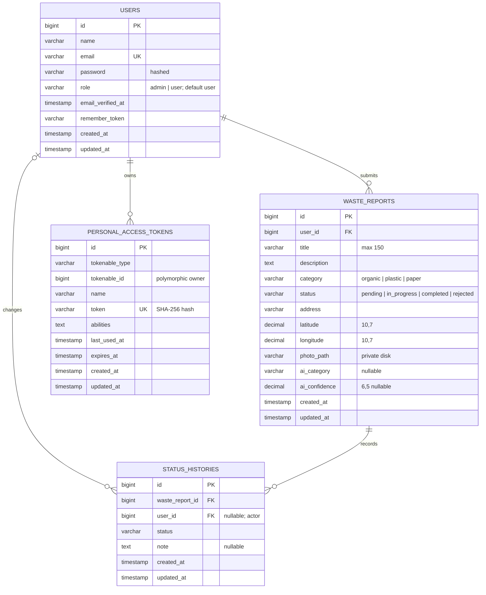

# Database dan ERD

Migration Laravel menjadi sumber kebenaran schema. Default SQLite; migration dapat digunakan dengan MySQL. Export SQLite aktual tersedia di [schema.sqlite.sql](schema.sqlite.sql) tanpa data atau kredensial.

## Relasi dan integritas

- User → laporan: satu ke banyak, `user_id` foreign key. Delete user **RESTRICT** saat masih memiliki laporan, sehingga data pelapor tidak hilang.
- Laporan → riwayat: satu ke banyak; delete laporan **CASCADE** riwayat.
- User → riwayat: actor admin/user yang melakukan tindakan. Foreign key nullable dengan **SET NULL** saat akun tanpa laporan dihapus; catatan penanganan tetap ada.
- Personal access tokens: relasi polymorphic bawaan Sanctum, tanpa foreign key SQL. Token mentah hanya diberikan sekali ke client; hash disimpan di database.
- Foto adalah path file privat; binary tidak dimasukkan ke database. Penghapusan laporan menghapus file setelah transaksi database berhasil. Jika penghapusan file gagal setelah commit, file yatim perlu dibersihkan operator.
- Status awal `pending` ditetapkan oleh default database. Enum PHP dan validasi request membatasi nilai status/kategori.
- Nilai confidence dari backend dibatasi 0–1. Latitude/longitude divalidasi terhadap rentang koordinat.
- Referensi seperti `SW-0048` diturunkan dari ID, bukan kolom tambahan.
- Status dan riwayat ditulis dalam transaksi dengan row lock. Edit/hapus memeriksa ulang policy dalam transaksi untuk menghindari perubahan status yang bersamaan.

## Index

- `users.email` unique; index `users.role`.
- Index `waste_reports.category`, `waste_reports.status`, serta composite `(user_id, created_at)`.
- Foreign key laporan/riwayat untuk integritas; primary key dipakai untuk pagination terbaru.
- Pencarian judul/alamat menggunakan LIKE. Untuk volume besar, tambahkan full-text search sesuai database yang dipilih.

## Tabel infrastruktur

Migration Laravel juga membuat `sessions`, `password_reset_tokens`, `cache`, `cache_locks`, `jobs`, `job_batches`, `failed_jobs`, dan `migrations`. Tidak semua fitur bawaan (misalnya reset password via email) diekspos oleh UI aplikasi ini. Tabel tersebut adalah infrastruktur framework, bukan fitur tambahan yang diklaim.

## Matriks akses

| Tindakan | Guest | User | Admin |
|---|---|---|---|
| Login/register | Ya | — | — |
| Buat laporan | Tidak | Ya | Ya |
| Daftar/detail/foto laporan | Tidak | Milik sendiri | Semua |
| Edit/hapus laporan | Tidak | Milik sendiri + pending | Semua |
| Update status | Tidak | Tidak | Ya |
| Statistik | Tidak | Milik sendiri | Semua |
| CRUD pengguna | Tidak | Tidak | Ya, dengan proteksi akun sendiri dan relasi |

Public registration tidak menerima role sebagai field mass-assignment. Model User tidak mengizinkan mass-assignment role. Endpoint admin mengubahnya secara eksplisit setelah middleware role.
