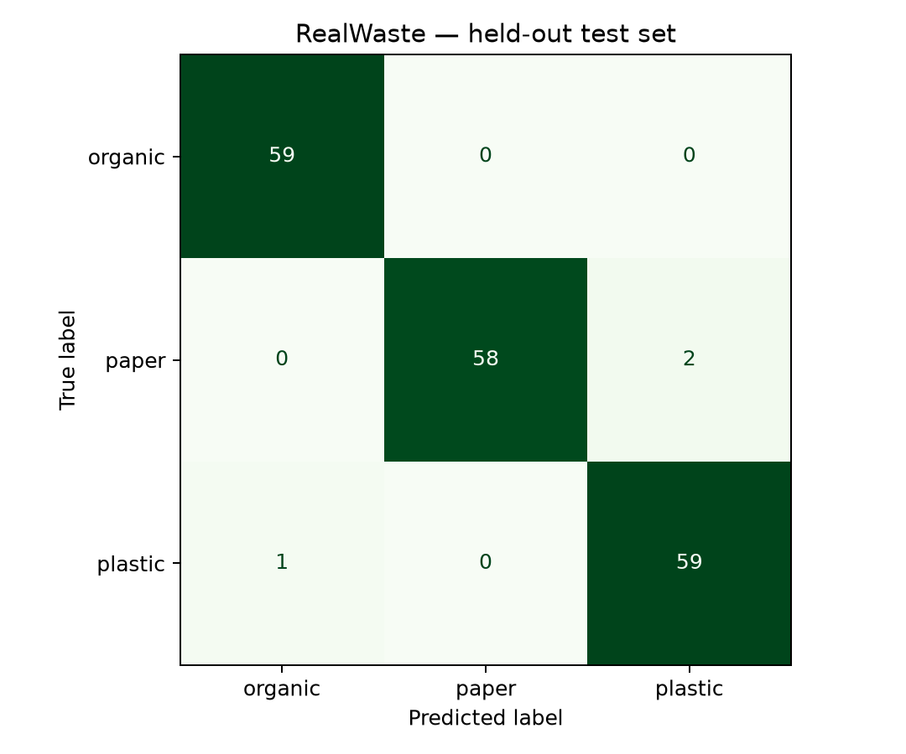
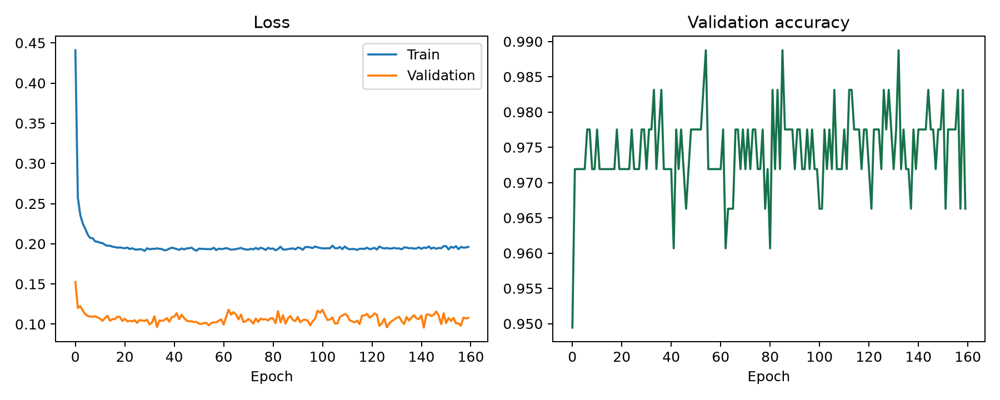

# Evaluasi model

Hasil di bawah berasal dari menjalankan `train.py` dan `evaluate.py`, bukan target atau angka contoh.

## Hasil testing

- **Accuracy: 98,3240% (176/179 benar).**
- Target >= 80%: **tercapai pada test set ini**.
- Macro F1: **0,983285**.
- Weighted F1: **0,983238**.
- Test set: **179 gambar**, terpisah dari training dan validasi.
- Seed: 42. Evaluasi tercatat pada 1 November 2026.
- [JSON evaluasi](artifacts/evaluation.json), [classification report teks](artifacts/classification_report.txt), [prediksi tiap gambar](artifacts/test_predictions.csv).

| Kelas | Precision | Recall | F1 | Support |
|---|---:|---:|---:|---:|
| Organic Waste | 0,9833 | 1,0000 | 0,9916 | 59 |
| Paper Waste | 1,0000 | 0,9667 | 0,9831 | 60 |
| Plastic Waste | 0,9672 | 0,9833 | 0,9752 | 60 |

## Confusion matrix

Baris = label asli; kolom = prediksi. Urutan selalu **organic, paper, plastic**.

| Aktual / Prediksi | Organic | Paper | Plastic |
|---|---:|---:|---:|
| Organic | 59 | 0 | 0 |
| Paper | 0 | 58 | 2 |
| Plastic | 1 | 0 | 59 |

## Training

- Framework: PyTorch CPU, torchvision.
- Backbone: **EfficientNet-B0** pretrained ImageNet (`IMAGENET1K_V1`).
- Backbone dibekukan; fitur global pooling 1.280 dimensi.
- Head yang dilatih: dropout 0,3 + linear 1.280 → 3.
- Preprocessing sama pada training/evaluasi/API: transform resmi bobot torchvision, RGB, resize/center crop ke 224, normalisasi ImageNet.
- Augmentasi train saja: original dan horizontal flip. Validation/test tidak diaugmentasi.
- Dataset: train 832, val 178, test 179.
- Optimizer AdamW, learning rate 0,002, weight decay 0,02, batch size head 64.
- Cross entropy training dengan label smoothing 0,05.
- **160 epoch**; checkpoint dipilih berdasarkan **validation cross entropy terendah**, pada **epoch 142**.
- Test set tidak dibaca oleh script training. Script evaluasi memverifikasi hash manifest sebelum membaca test.
- Detail per epoch: [training.json](artifacts/training.json).

## Identitas artefak

- Model: `artifacts/model.pt`.
- SHA-256 model: `0f887bf8c66e5c3801a0e0754d5104a7d442e4f15865e73c9482169399155ace`.
- SHA-256 manifest: `a1950235015c620417d703037709bc1e915f9f932fac7c8823d0fc175ec92200`.
- Dependensi aktual: `requirements-lock.txt`.

## Interpretasi dan batas

Angka 98,32% mengukur klasifikasi **subset RealWaste tiga kelas** pada kondisi sumber dataset. Ini bukan bukti akurasi setara pada foto jalanan Indonesia, sampah bercampur, kamera berbeda, atau kelas lain. Deduplikasi heuristik tidak menjamin objek fisik berbeda antarsplit; lihat [DATASET.md](DATASET.md).

Model selalu memilih satu dari tiga kelas, termasuk bila gambar sebenarnya bukan sampah. Tidak ada deteksi bounding box atau penolakan out-of-distribution. Confidence softmax belum dikalibrasi. Karena itu UI menampilkan hasil sebagai saran, menyediakan kategori manual, dan menandai confidence di bawah 70% untuk pemeriksaan.

Langkah peningkatan: kumpulkan test set lapangan yang terpisah berdasarkan lokasi/sesi, tambahkan kelas unknown/mixed, evaluasi kalibrasi confidence, dan fine-tune backbone dengan data representatif. Jangan memilih parameter berdasarkan hasil test yang sudah dilihat.
